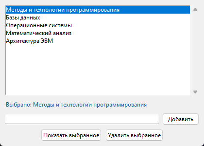
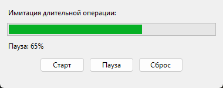
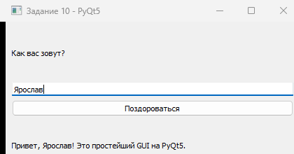
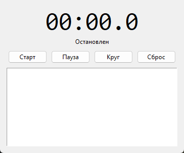
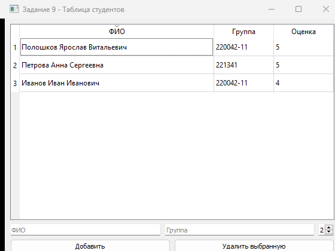

Полошков Ярослав Витальевич, группа 220042-11, вариант 4, лабораторная №5

# Лабораторная работа №5. Визуальное программирование на Python

Дисциплина: «Методы и технологии программирования» (часть 1).

**Цель работы:** научиться создавать графические интерфейсы с
использованием Tkinter и PyQt.

Окружение: Python 3.11.1, Windows, Tkinter 8.6 (из коробки),
PyQt5 5.15.2 (`pip install -r requirements.txt`). Для вспомогательного
скрипта съёмки скриншотов дополнительно нужны Pillow и pywin32 —
сами приложения их не используют.

## Задания варианта 4

По таблице индивидуальных вариантов (строка «4»: `4 6 10 | 5 9`):

| Сложность | № | Задание | Файл | Скриншот |
|-----------|---|---------|------|----------|
| Средняя | 4 | Список (Listbox) и выбор элемента | [`task04_listbox.py`](task04_listbox.py) | [png](screenshots/task04_listbox.png) |
| Средняя | 6 | Прогрессбар | [`task06_progressbar.py`](task06_progressbar.py) | [png](screenshots/task06_progressbar.png) |
| Средняя | 10 | Простейший GUI на PyQt5 | [`task10_pyqt_hello.py`](task10_pyqt_hello.py) | [png](screenshots/task10_pyqt_hello.png) |
| Повышенная | 5 | Программа таймер/секундомер | [`task05_timer_stopwatch.py`](task05_timer_stopwatch.py) | [png](screenshots/task05_stopwatch.png) |
| Повышенная | 9 | Приложение PyQt с таблицей | [`task09_pyqt_table.py`](task09_pyqt_table.py) | [png](screenshots/task09_pyqt_table.png) |

Во всех программах логика отделена от GUI в отдельные модели
(`ItemListModel`, `ProgressModel`, `StopwatchModel`,
`StudentTableModel`, функция `make_greeting`), поэтому поведение
проверяется модульными тестами без окон. Дополнительно есть GUI
smoke-тесты: Tkinter — на скрытом окне (`withdraw`), PyQt5 — в
offscreen-режиме. Протокол прогонов — в [`demo_output.txt`](demo_output.txt).

---

## Средняя сложность

### Задание 4. Список (Listbox) и выбор элемента

Tkinter-окно со списком дисциплин: `Listbox` с прокруткой, выделенный
пункт показывается в метке «Выбрано: …», свои пункты добавляются через
поле ввода (Enter или кнопка), выделенный пункт можно удалить. Модель
`ItemListModel` отклоняет пустые и повторные пункты и проверяет
индексы. Обработчики кнопок вызываются в GUI smoke-тесте.



### Задание 6. Прогрессбар

`ttk.Progressbar` с кнопками «Старт», «Пауза», «Сброс». Отсчёт идёт
через `after(50)` — цикл событий не блокируется, окно остаётся
отзывчивым. Модель `ProgressModel` хранит значение 0–100 и состояние;
по достижении 100 % отсчёт сам останавливается, повторный «Старт»
начинает заново. Пауза отменяет pending-вызов `after_cancel`.



### Задание 10. Простейший GUI на PyQt5

`QMainWindow` с `QLineEdit`, `QPushButton` и `QLabel`: ввод имени,
приветствие по кнопке или Enter. Текст формирует чистая функция
`make_greeting` (пустое имя → подсказка), поэтому логика покрыта
тестами без окон; само окно проверяется offscreen smoke-тестом.



---

## Повышенная сложность

### Задание 5. Программа таймер/секундомер

Секундомер с точностью до десятых долей: «Старт», «Пауза», «Сброс»
и «Круг» (отсечки в списке). Время считается по `time.monotonic()`,
а не по числу срабатываний таймера, поэтому не «плавает» при
подвисаниях GUI. `StopwatchModel` получает часы через конструктор —
в тестах время подменяется, и проверяются пауза, накопление отрезков,
повторный старт, отсечки и сброс.



### Задание 9. Приложение PyQt с таблицей

`QTableWidget` со студентами (ФИО, группа, оценка): добавление записи
с валидацией, удаление выбранной строки, сортировка кликом по
заголовку, автоподсчёт среднего балла. Данные хранит
`StudentTableModel` (dataclass `StudentRow`), тесты проверяют
добавление, удаление, сортировку по столбцам и средний балл.



---

## Проверка качества

### Модульные тесты

```
$ py -3 -m unittest -v
...
Ran 24 tests in 0.265s

OK
```

24 теста: модели всех пяти заданий (включая граничные случаи — пустые
и повторные пункты, 100 % прогресса, повторный старт секундомера,
некорректная оценка, пустая таблица) плюс GUI smoke-тесты окон:
Tkinter на скрытом `root`, PyQt5 с `QT_QPA_PLATFORM=offscreen`, окна
на экране не появляются. Полный вывод — в `demo_output.txt`.

### Соответствие PEP8

```
$ py -3 -m flake8 .
(команда не вывела ни одной строки)
код возврата: 0
```

Строки не длиннее 79 символов, docstring у каждого модуля, класса и
метода, аннотации типов, магические значения вынесены в константы
(`TICK_MS`, `STEP_PERCENT`, `REFRESH_MS`, `COLUMNS`).

## Структура репозитория

| Файл | Назначение |
|------|------------|
| `README.md` | Данные студента (первая строка) и отчёт по заданиям |
| `task04_listbox.py` | Задание 4 (средняя): Listbox и выбор элемента |
| `task06_progressbar.py` | Задание 6 (средняя): прогрессбар на `after()` |
| `task10_pyqt_hello.py` | Задание 10 (средняя): простейший GUI на PyQt5 |
| `task05_timer_stopwatch.py` | Задание 5 (повышенная): секундомер с кругами |
| `task09_pyqt_table.py` | Задание 9 (повышенная): PyQt-таблица студентов |
| `test_tasks.py` | 24 теста: модели + GUI smoke (`py -3 -m unittest -v`) |
| `demo_output.txt` | Протокол: тесты, flake8, съёмка скриншотов |
| `collect_demo.py` | Скрипт, которым собран `demo_output.txt` |
| `make_screenshots.py` | Съёмка всех окон в `screenshots/` |
| `screenshots/*.png` | Фактические скриншоты пяти окон |
| `requirements.txt` | PyQt5; Pillow и pywin32 — только для скриншотов |
| `.gitignore` | Исключения для Python-проекта |

## Как запустить

```bash
pip install -r requirements.txt

python task04_listbox.py
python task06_progressbar.py
python task10_pyqt_hello.py
python task05_timer_stopwatch.py
python task09_pyqt_table.py

python -m unittest -v        # тесты
python -m flake8 .           # проверка стиля (если установлен flake8)
python make_screenshots.py   # переснять скриншоты окон
```

Работа велась в feature-ветках: каждое задание — отдельная ветка,
слитая в `main` merge-коммитом (`--no-ff`). Сообщения коммитов — по
Conventional Commits (`feat:`, `test:`, `docs:`, `chore:`).
